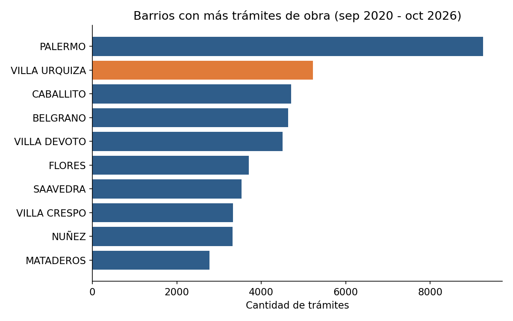
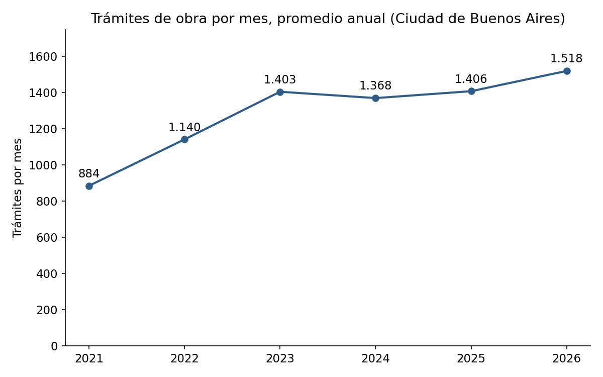
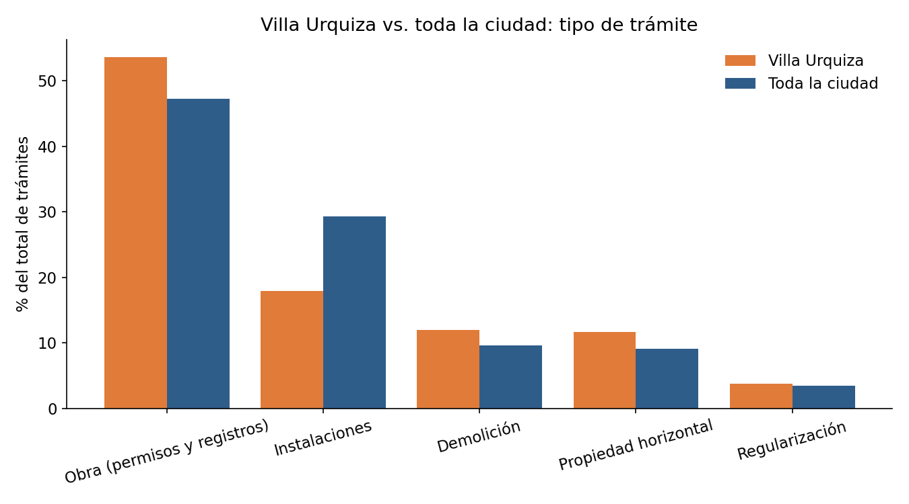
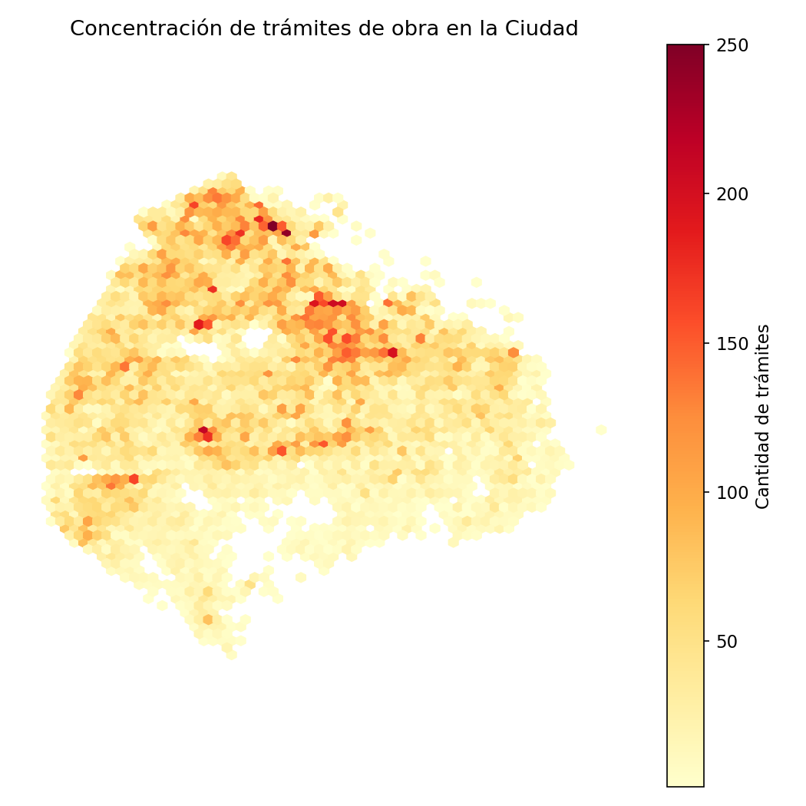

# Análisis de la actividad constructiva en la Ciudad de Buenos Aires

Análisis de 90.515 trámites de obra registrados en la Ciudad entre septiembre de 2020 y octubre de 2026, con Python y SQL.

**App online: [obras-caba.streamlit.app](https://obras-caba.streamlit.app/)**: escribí una dirección y mirá todas las obras, demoliciones y trámites registrados a tu alrededor, comparados con el resto de la Ciudad.

## Principales hallazgos

**1. Villa Urquiza es el segundo barrio con más actividad de la Ciudad**, solo detrás de Palermo.



**2. La actividad creció un 72% entre 2021 y 2026.** 2026 es el año récord, con 1.518 trámites por mes en promedio.



**3. Villa Urquiza está pasando de casas a edificios.** Comparada con el resto de la Ciudad, tiene más demoliciones (12,0% contra 9,6%) y más planos de propiedad horizontal nuevos (11,6% contra 9,1%), y menos trámites de instalaciones, que son típicos de zonas de oficinas y comercios.



**4. Los barrios que más se renuevan.** Floresta, Versalles, Chacarita, Villa Devoto, Villa Urquiza y Saavedra tienen más de un 12% de demoliciones sobre su total de trámites. Palermo y Belgrano, con mucha actividad, tienen menos del 10%: ya están densificados.



## Datos

- Fuente: [Obras registradas](https://data.buenosaires.gob.ar/dataset/obras-registradas), portal de datos abiertos de la Ciudad de Buenos Aires.
- 2020 y 2026 están incompletos (los datos van del 29/09/2020 al 21/10/2026), por eso los años se comparan con el promedio mensual y 2020 queda fuera de las conclusiones.
- Los 116 tipos de trámite se agruparon en 7 categorías (obra, instalaciones, demolición, propiedad horizontal, regularización, ampliación y otros).

## Cómo ejecutarlo

1. Descargar el CSV desde el link de arriba y guardarlo como `data/raw/obras_registradas.csv`
2. Instalar las librerías: `pip install -r requirements.txt`
3. Ejecutar en orden:

```
python src/limpieza.py
python src/cargar_db.py
python src/consultas.py
python src/graficos.py
```

Tests: `python -m pytest`

App local: `streamlit run app/app.py`

## Estructura

- `src/limpieza.py`: limpieza de datos y categorización de trámites
- `src/cargar_db.py`: carga de los datos en una base SQLite
- `src/consultas.py`: consultas SQL
- `src/graficos.py`: gráficos
- `app/app.py`: aplicación web (Streamlit)
- `tests/`: tests de la limpieza

## Herramientas

Python, pandas, SQL (SQLite), matplotlib, Streamlit, pydeck, pytest, Git.
